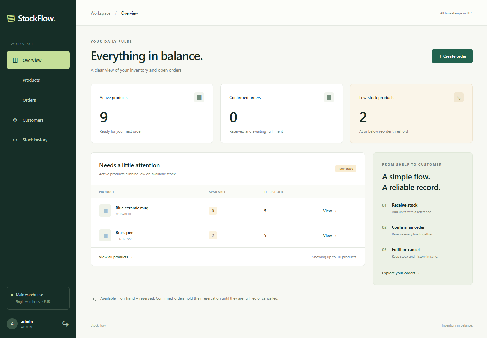

# StockFlow

[](https://github.com/BoyanChakarov/stockflow/actions/workflows/ci.yml)

Inventory and order management for a small internal team. Receive stock, reserve it for an order, and fulfil or cancel that order with a consistent movement history. One warehouse, whole units, EUR quoted totals.



Built as a Java engineering portfolio project: database transactions, deterministic row locking, frozen order snapshots, session security, persistent idempotency, and real PostgreSQL concurrency tests. Demo records are synthetic.

## Quick start

Requirements: Docker Engine/Desktop with Linux containers and Docker Compose v2. The container build includes Java and Maven; a host JDK is unnecessary for this path.

```bash
git clone https://github.com/BoyanChakarov/stockflow.git
cd stockflow
cp .env.example .env
# Edit .env: replace all three password placeholders with your own local values.
docker compose up --build --wait
```

On Windows PowerShell, use `Copy-Item .env.example .env` instead of `cp`. Open [localhost:8080](http://localhost:8080). Sign in as `admin` with `STOCKFLOW_ADMIN_PASSWORD`, or `staff` with `STOCKFLOW_STAFF_PASSWORD`. Passwords are BCrypt-hashed on first initialization and **are not reset by restarting** or changing the environment later. The explicit `demo` profile creates 10 products, three customers, and two accounts once. Blue ceramic mug starts at zero stock for the demonstration.

The app binds only to `127.0.0.1:8080`; PostgreSQL stays inside the Compose network. Database readiness and application/database health checks are included. Data persists in the `db-data` named volume.

```bash
docker compose down              # Stop, preserving data
docker compose up --wait         # Start again
```

**Destructive demo reset:** `docker compose down --volumes` deletes the named volume and all local demo records. Use this only when intentionally starting over.

## What is implemented

- ADMIN manages products, archiving, receipts, signed corrections, and complete stock history.
- ADMIN and STAFF manage customers and create, fulfil, cancel, and inspect all orders. Only ADMIN archives/reactivates customers.
- Catalogue/customer search, active-state filters, pagination, stock counters, date/status/customer order filters, and dashboard low-stock metrics.
- Atomic reservations across up to 50 distinct products; any shortage rejects the entire order.
- Immutable order line prices/names/SKUs and customer contact snapshots. Later edits preserve historical display.
- Duplicate order, receipt, and correction requests return their original successful result. A key with a different normalized payload conflicts.
- CSRF-protected form login/logout and REST API; server-side sessions; unknown input fields rejected; consistent errors with request IDs.
- Responsive Thymeleaf screens with permission-aware controls and retry state in `sessionStorage`, including recovery after a lost successful response.

## Stack and verification

Java 21, Spring Boot **4.1.1**, Spring MVC, Spring Data JPA/Hibernate, Spring Security, Bean Validation, Flyway, Thymeleaf, and PostgreSQL **18.0**. Maven Wrapper **3.9.11**, JUnit Jupiter/Testcontainers versions managed by the exact Boot BOM, Surefire/Failsafe **3.5.4**, JaCoCo **0.8.14**. PostgreSQL and Temurin container digests and GitHub Action commit SHAs are pinned. See [baseline decisions](docs/decisions/001-baseline.md).

With Java 21 and a running Docker engine:

```bash
./mvnw --batch-mode clean verify
# Windows: .\mvnw.cmd --batch-mode clean verify
```

Surefire runs unit tests; Failsafe runs PostgreSQL, HTTP/security, rollback, and concurrency integration tests. Docker absence fails the default suite instead of skipping it. Reports: `target/surefire-reports`, `target/failsafe-reports`, `target/site/jacoco/index.html`.

The concurrency suite coordinates independent committed transactions for last-unit competition, reverse product ordering, fulfil/cancel races, adjustment/create races, and identical idempotency keys. Every business integration test reconciles movement deltas and confirmed reservations. [Testing and acceptance map](docs/testing.md).

GitHub Actions runs the full suite, publishes reports, builds and starts the Compose stack from an empty database, executes a Chromium browser workflow and API smoke test, restarts the app, and verifies persisted balances/idempotency. [Workflow runs](https://github.com/BoyanChakarov/stockflow/actions/workflows/ci.yml).

## Local Java development

```bash
docker compose -f compose.yaml -f compose.dev.yaml up -d db
# Export POSTGRES_USER, POSTGRES_PASSWORD, STOCKFLOW_ADMIN_PASSWORD,
# STOCKFLOW_STAFF_PASSWORD from your local .env into the shell.
export SPRING_DATASOURCE_URL=jdbc:postgresql://localhost:5432/stockflow
export SPRING_PROFILES_ACTIVE=demo
./mvnw spring-boot:run
```

Maven does not automatically load `.env`; Docker Compose does. In PowerShell use `$env:NAME='your-local-value'` and `.\mvnw.cmd spring-boot:run`. If `POSTGRES_DB` differs, change the JDBC database name too. The development override exposes PostgreSQL only on loopback port 5432.

## Explore

- [Seven-stage implementation plan](docs/IMPLEMENTATION_PLAN.md)
- [Scope and original implementation specification](docs/MVP_SCOPE.md)
- [Architecture and transaction boundaries](docs/architecture.md)
- [OpenAPI 3.1 contract](docs/openapi.yaml)
- [Ten-step demonstration](docs/demo.md)
- [Testing, browser automation, and acceptance mapping](docs/testing.md)
- [Verification record and release checks](docs/verification.md)

## Boundaries

This MVP has no public registration, password reset, account administration, payments, invoices/tax, partial fulfilment, returns, multiple warehouses, or reservation expiry. An order's quoted total is not revenue. There is no public hosted backend; GitHub publishes the source. In-memory sessions may end on restart; business records remain in PostgreSQL.

`prod` enables Secure cookies and excludes demo initialization. A real rollout also needs account provisioning/lifecycle, backup/restore procedures, operational monitoring, and deployment-specific HTTPS/database access controls. No production users, traffic, uptime, or performance claims are made.

MIT license · Boyan Chakarov
